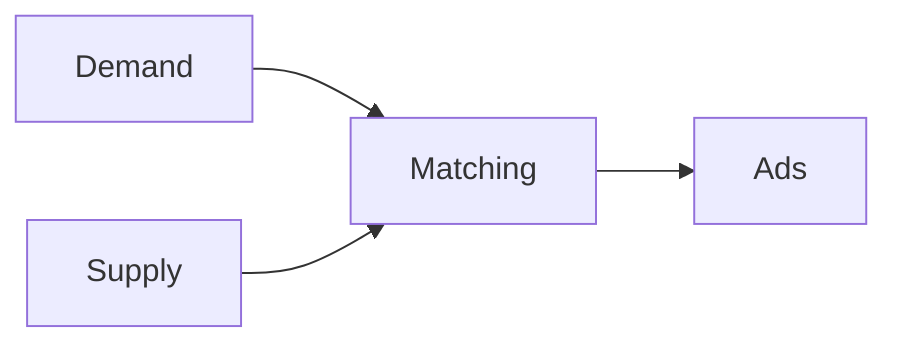

# arjunkul.github.io

A small personal blog built with [Hugo](https://gohugo.io/) and the [Cactus](https://github.com/iahsanujunda/hugo-theme-cactus) theme.

Clone the theme submodule along with the repository:

```sh
git clone --recurse-submodules https://github.com/arjunkul/arjunkul.github.io.git
```

## Run locally

Install Hugo extended 0.158.0 or newer and Dart Sass, then start the development server:

```sh
brew install dart-sass
hugo server -D
```

Open <http://localhost:1313>.

## Add a post

```sh
hugo new content posts/my-post.md
```

Edit the generated Markdown file, add `type: blog` to its front matter, and set `draft: false` when it is ready.

## Add a diagram

Use a fenced `mermaid` block in any post:

````markdown

````

The diagram is rendered in the browser and matches the configured Cactus color scheme.

## Publish

Push to `master`. The GitHub Actions workflow builds the site and deploys it to GitHub Pages. In the repository settings, set **Pages → Source** to **GitHub Actions** the first time.
